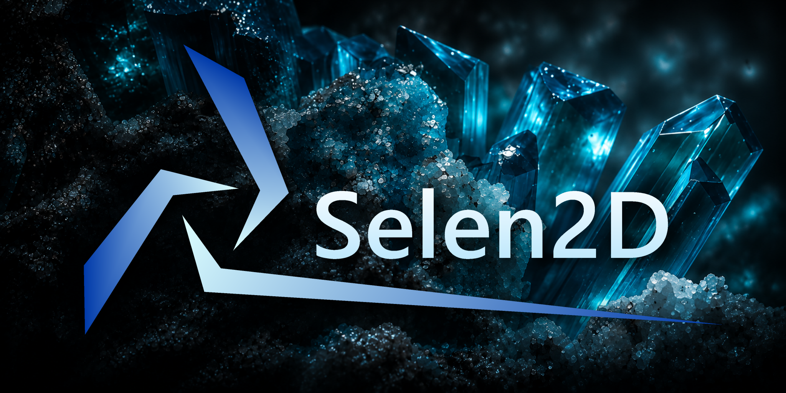
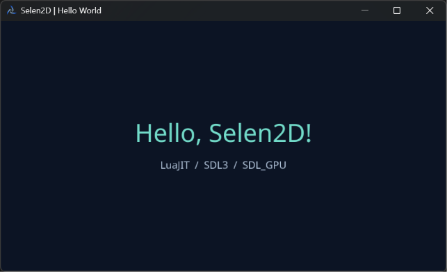
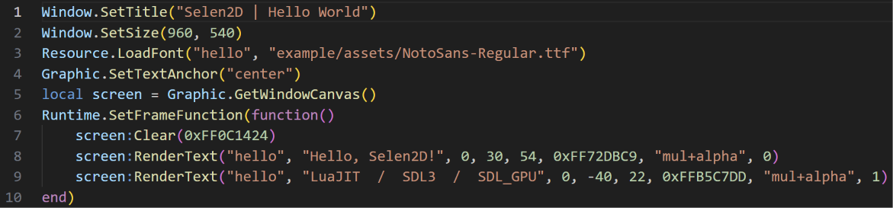

<p align="center">
  <strong>Selen2D, A lightweight, LuaJIT-driven 2D game engine.</strong><br />
  <strong>Selen2D, 轻量级 LuaJIT 驱动的 2D 游戏引擎。</strong><br />
  <strong>Selen2D, LuaJIT を中心とした軽量な 2D ゲームエンジン。</strong>
</p>
<p align="center">
  
</p>
<p align="center">
  <a href="https://github.com/phsonh/Selen2D/releases/latest">Latest release</a> ·
  <a href="https://github.com/phsonh/Selen2D/blob/develop/doc/guide/README.md">Guides</a> ·
  <a href="https://github.com/phsonh/Selen2D/blob/develop/doc/api">Lua API</a> ·
  <a href="https://github.com/phsonh/Selen2D/blob/develop/LICENSE">MIT License</a>
</p>
<p align="center">
  <a href="https://github.com/phsonh/Selen2D/tree/develop#english">English</a> ·
  <a href="https://github.com/phsonh/Selen2D/tree/develop#%E7%AE%80%E4%BD%93%E4%B8%AD%E6%96%87">简体中文</a> ·
  <a href="https://github.com/phsonh/Selen2D/tree/develop#%E6%97%A5%E6%9C%AC%E8%AA%9E">日本語</a>
</p>

---

<a id="english"></a>
## English

### Make the game yours. Keep the engine small.

**Selen2D** is a C++20 / LuaJIT game engine for developers who want to build 2D games with direct control over their update loop, rendering, and resource lifetimes. It uses **SDL3 / SDL_GPU**, supports programmable **HLSL shaders** and offscreen canvases, and includes selected 3D rendering features for effects and experiments.

You write the game in Lua. Selen2D provides the native foundation; it does **not** require a scene editor, enforce a particular game-object architecture, or manage your game loop behind your back. This makes it a natural fit for hand-authored 2D action games, bullet-hell/STG gameplay, and projects where render order and simulation steps matter.

> **Versions:** The latest published stable release is **v2.1.0** (Windows x64 / Direct3D 12). The `develop` branch contains **unreleased 2.1.1 development changes** being prepared for a future v2.2.0 release. Do not assume every feature described for `develop` is available in the v2.1.0 ZIP.

### Where Selen2D fits

Selen2D does not try to replace other Lua engines feature for feature. The difference is the workflow you want:

| Engine | Primary approach | A good choice when… |
|:--|:--|:--|
| **Selen2D** | Lua-managed frame and object lifecycle, native SDL_GPU rendering, explicit resource ownership and optional compiled-in package configuration | You prefer writing your own game structure and controlling the rendering/simulation order. |
| [**LÖVE**](https://love2d.org/) | A friendly, code-first Lua 2D framework built around callbacks | You want a widely used Lua framework and a straightforward start without a dedicated editor. |
| [**Defold**](https://defold.com/) | An integrated game engine, visual editor and deployment pipeline, with Lua game logic | You want an integrated scene/UI/editor workflow and broad platform tooling. |

These are different trade-offs, not performance rankings. Selen2D is **not API-compatible** with LÖVE or Defold, and its currently validated binary target is Windows x64—not a claim of equivalent cross-platform support.

### Hello World — your first `main.lua`

Save these **10 lines** as `main.lua` in the unpacked **new development/public-layout build**. They use the font shipped in `example/assets/` and draw directly to the window canvas:

```lua
Window.SetTitle("Selen2D | Hello World")
Window.SetSize(960, 540)
Resource.LoadFont("hello", "example/assets/NotoSans-Regular.ttf")
Graphic.SetTextAnchor("center")
local screen = Graphic.GetWindowCanvas()
Runtime.SetFrameFunction(function()
    screen:Clear(0xFF0C1424)
    screen:RenderText("hello", "Hello, Selen2D!", 0, 30, 54, 0xFF72DBC9, "mul+alpha", 0)
    screen:RenderText("hello", "LuaJIT  /  SDL3  /  SDL_GPU", 0, -40, 22, 0xFFB5C7DD, "mul+alpha", 1)
end)
```

**Using the currently published v2.1.0?** Its compiled entry is **`example/main.lua`**, not the root `main.lua`. Back up and replace `example/main.lua` with this code to try it on v2.1.0. The upcoming default layout starts the **root `main.lua`**, which normally delegates to `example/main.lua` using `File.RunLuaFile()`. Close and restart the EXE after editing: there is no automatic Lua hot reload.

**Real result — captured on Windows:**

<p align="center">
  <a href="doc/example/hello_world_test2.png"></a>
</p>
<p align="center"><sub>Actual engine output, not a concept render. Click to view the image.</sub></p>

<details>
<summary>View the Lua source screenshot</summary>



</details>

### What is included?

- **Lua-driven runtime:** one explicit frame callback; your code chooses when to call `Object.Commit()`, update objects, resolve collisions, and render.
- **2D graphics and effects:** window and offscreen canvases, Canvas3D, dynamic meshes, custom HLSL via `Engine.hlsl`, configurable blending and fog, text layout, and PNG readback.
- **Resources and audio:** asynchronous batch loaders, atomic resource publication, image/font/shader/sound/music resources, and explicit audio players.
- **Input, math and files:** keyboard/mouse/gamepad state, frame-based utilities, independent random streams, and an authorized virtual filesystem.
- **Optional packaged games:** Zstd-backed SLPK v1 packages or authenticated encrypted SLPK v2 packages; package overlay order is set by `parts` in the startup configuration.
- **Readable Lua APIs:** editor declarations in [`doc/api/`](doc/api/) and task-oriented guides in [`doc/guide/`](doc/guide/).

Selen2D supplies the building blocks, not a built-in scene editor, visual scripting environment, or full UI framework.

### Choose a path

| | **A. Release user** | **B. Game project developer** |
|:--|:--|:--|
| Get started | Download the ready-to-run ZIP | Clone and build Selen2D source |
| Write game logic | Edit the distributed Lua files | Keep Lua/resources in an independent game folder |
| Build C++ | **No** | **Yes**, for a custom startup configuration |
| Package encryption | Not required | Optional SLPK v2 encryption |
| Python / Qt | Not required | PyQt6 tool and Python build dependencies (on the dev machine) |

### A — Download, edit Lua, play

1. Download the Windows x64 ZIP from [Releases](https://github.com/phsonh/Selen2D/releases/latest) and extract it to a writable folder.
2. Run `Selen2D.exe`. The included **Orbit Garden** example demonstrates a menu, loading screen, movement, pause, audio, and cleanup.
3. Change a Lua or HLSL file and restart the executable. No engine rebuild is required for ordinary authorized game files.

**Current v2.1.0 layout:**

```text
Selen2D/
├── Selen2D.exe
├── example/
│   ├── main.lua             # v2.1.0 compiled entry
│   ├── effect.hlsl
│   ├── palette.hlsl
│   └── assets/
└── doc/
    ├── guide/
    └── api/
```

**Upcoming default layout on `develop` / for v2.2.0:**

```text
Selen2D/
├── Selen2D.exe
├── main.lua                 # minimal startup: File.RunLuaFile("example/main.lua")
├── example/                 # complete, editable Orbit Garden project
│   ├── main.lua
│   ├── effect.hlsl
│   ├── palette.hlsl
│   └── assets/
└── doc/
    ├── guide/
    └── api/
```

In the upcoming default layout, the compiled entry is the root `main.lua`, and the ordinary deployment-root files can be accessed through safe relative VFS paths. To run your own game, replace the root startup script or place your scripts in subdirectories. The `example/` folder remains available as a reference; you do not have to use it.

**Orbit Garden controls:** `Enter` starts; `WASD` / arrow keys move; `P` or `Space` pauses; `Esc` returns to the menu or quits. The standard ZIP needs no Python, GUI, resource encryption, or SDK.

### B — Build a dedicated executable for a separate game

**Keep the engine and your game independent.** Selen2D is the engine repository, not the place to commit your game's code or assets.

```text
Workspace/
├── Selen2D/                 # engine source, build scripts, PyQt6 tools
└── MyGame/                  # your separate project / repository
    ├── content/
    │   ├── main.lua
    │   └── assets/
    └── dist/
        ├── Selen2D.exe     # custom engine build
        └── data.slpk       # packaged game content
```

For the **unreleased development tooling**, the intended workflow is:

1. Clone the engine source and switch to `develop`. Install Visual Studio C++ tools, the supported Windows SDK, CMake, Ninja and Python.
2. Install the optional PyQt6 tools into an isolated Python environment, then launch the desktop UI.
3. Configure **one private file**: `Selen2D/launch/launch.json`. Set the virtual entry, package mounts, `parts`, optional encryption secret and writable directories. Save and validate.
4. Run `tools/build.ps1 -Configuration Release` (or use the GUI Build tab). The build embeds the chosen JSON configuration into `Selen2D.exe`; the game does **not** load JSON at runtime.
5. In the GUI Package tab, pack your external `MyGame/content/` directory, reusing the **same secret** for encrypted SLPK v2 output. Verify the result.
6. Copy the built EXE and the packaged file(s) into `MyGame/dist/`, and launch them together. Distribute the applicable license notices too.

```powershell
# In the Selen2D repository (the current development branch):
git switch develop
python -m venv build/tools-venv
.\build\tools-venv\Scripts\python.exe -m pip install -r tools/pack/requirements-gui.txt
.\build\tools-venv\Scripts\python.exe -B tools/pack/main.py
.\tools\build.ps1 -Configuration Release
```

**Target JSON schema for v2.2.0** (directory type names are undergoing final review on `develop`; use the matching branch documentation when actually building):

```json
{
  "secret": "replace-with-your-private-project-secret",
  "mounts": [
    { "source": "data.slpk", "target": "game", "parts": 0, "encrypted": true }
  ],
  "directories": [
    { "base": "local_app_data", "path": "ExampleStudio/MyGame", "target": "save" }
  ],
  "entry": "game/main.lua"
}
```

The packed `content/main.lua` becomes `game/main.lua` in the VFS. `source` names a file relative to the **deployed EXE**, not the input folder selected in the GUI. `local_app_data` maps to `%LOCALAPPDATA%` on Windows; Lua accesses it using paths such as `save/settings.json`. A development project may use a different authorized mapping. The **official public Release** is built separately with a secret-free example configuration and never inherits a private project secret.

Need CLI automation instead of the GUI? See [JSON / packaging](doc/guide/file-launch.md). Neither Python nor PyQt6 is required on the player's machine. Encryption raises the difficulty of direct inspection; it is **not** a guarantee against reverse engineering or tampering.

### Platform, documentation and licensing

- **Validated binaries:** Windows x64, Direct3D 12. Other platforms are not claimed as equivalent release targets.
- **Start here:** [Getting started](doc/guide/getting-started.md), [Orbit Garden](doc/guide/example.md), [Shader guide](doc/guide/shader.md), [Runtime & objects](doc/guide/runtime.md).
- **Specialized guides:** [File / VFS / launch JSON](doc/guide/file-launch.md), [PyQt6 tools](doc/guide/tools-gui.md), [Audio](doc/guide/audio.md), [Text](doc/guide/text.md), [Console & diagnostics](doc/guide/debug-console.md).
- **Reference:** [`doc/api/`](doc/api/) contains Lua language-server/editor declarations, **not Lua implementations to execute**.
- **License:** engine-owned code is available under the [MIT License](LICENSE), copyright © 2026 Lonely Owl. The ZIP also contains third-party licenses and notices; preserve them when redistributing. PyQt6 used by the optional developer GUI has separate GPL/commercial terms.
- **Contributing:** development branches, release policy and source-building guidelines are in [`CONTRIBUTING.md`](CONTRIBUTING.md).

---

<a id="简体中文"></a>
## 简体中文

### 用 Lua 写游戏，把控制权留给自己

**Selen2D** 是基于 **C++20、LuaJIT 和 SDL3 / SDL_GPU** 的轻量级游戏引擎，主要面向 2D 游戏，也提供 Canvas3D 等部分 3D 绘制能力。它特别适合希望自己安排游戏流程、对象更新、弹幕碰撞和画面合成顺序的开发者。

游戏逻辑由 Lua 编写，引擎负责原生窗口、输入、图形、音频、资源与文件服务。**Selen2D 不强制使用场景编辑器、固定的游戏对象体系或自动调度框架。** 你决定什么时候更新、碰撞和绘制。

> **版本说明：** 当前已经正式发布的是 **v2.1.0**（Windows x64 / Direct3D 12）。`develop` 上的 **2.1.1 为尚未发布的开发修订**，正为后续 v2.2.0 做准备。请勿把开发分支的新功能误认为已经包含在 v2.1.0 ZIP 中。

### 与 LÖVE、Defold 的区别

Selen2D 并非要在所有功能上取代其他 Lua 引擎，而是提供不同的工作方式。

| 引擎 | 主要定位 | 适合什么开发者 |
|:--|:--|:--|
| **Selen2D** | Lua 自行控制帧与对象生命周期，SDL_GPU 原生渲染、HLSL 和可选的编译期资源包配置 | 希望自行组织游戏结构，精确控制模拟和渲染顺序。 |
| [**LÖVE**](https://love2d.org/) | 以 Lua 回调为核心、易于上手的代码式 2D 框架 | 希望快速编写 Lua 2D 游戏，不需要专门的可视化编辑器。 |
| [**Defold**](https://defold.com/) | 集成编辑器、游戏引擎和发布工具链，使用 Lua 开发游戏逻辑 | 希望使用完整的场景、UI、编辑器与多平台发布工作流。 |

这些是设计取舍，不是性能排行榜。Selen2D 与 LÖVE、Defold 的 API **并不兼容**；目前也没有宣称具备后两者全部平台与编辑器能力。

### 十行 Lua：Hello World

在**新开发版 / 即将采用的标准发行布局**中，把下面十行代码保存到 EXE 同目录的 `main.lua`。它调用发行包内已有的字体，直接在窗口里绘制文字：

```lua
Window.SetTitle("Selen2D | Hello World")
Window.SetSize(960, 540)
Resource.LoadFont("hello", "example/assets/NotoSans-Regular.ttf")
Graphic.SetTextAnchor("center")
local screen = Graphic.GetWindowCanvas()
Runtime.SetFrameFunction(function()
    screen:Clear(0xFF0C1424)
    screen:RenderText("hello", "Hello, Selen2D!", 0, 30, 54, 0xFF72DBC9, "mul+alpha", 0)
    screen:RenderText("hello", "LuaJIT  /  SDL3  /  SDL_GPU", 0, -40, 22, 0xFFB5C7DD, "mul+alpha", 1)
end)
```

**如果使用当前 v2.1.0 Release：** 它实际执行的是 `example/main.lua`，不是根目录的 `main.lua`。请先备份并替换 `example/main.lua` 来测试这段代码。新的开发版会把根目录 `main.lua` 设为入口，默认通过 `File.RunLuaFile("example/main.lua")` 启动示例。修改 Lua 后关闭并重新运行 EXE 即可，当前没有自动热重载。

**实际运行效果（Windows 实机截图）：**

<p align="center">
  <a href="doc/example/hello_world_test2.png"></a>
</p>
<p align="center"><sub>这是引擎真实运行画面，并非概念效果图。点击图片可查看原图。</sub></p>

<details>
<summary>展开查看 Lua 源码截图</summary>


</details>

### 功能一览

- **Lua 主导的运行循环**：注册帧回调，显式调用 `Object.Commit()`，自行控制对象更新、碰撞检查与绘制顺序。
- **2D 渲染与特效**：窗口画布、离屏 Canvas、Canvas3D、动态 Mesh、`Engine.hlsl` 自定义 HLSL Shader、混合模式、雾效、文字排版与 PNG 读回。
- **资源与音频**：支持异步批量加载及整批发布，图片、字体、Shader、Sound、Music 和显式 Audio Player。
- **输入、数学与文件**：键盘／鼠标／手柄输入、帧计时、独立随机数流和受授权的虚拟文件系统（VFS）。
- **可选资源包**：普通 SLPK v1 或认证加密 SLPK v2；`parts` 定义包之间的挂载覆盖优先级。
- **完整参考资料**：[`doc/api/`](doc/api/) 编辑器声明和 [`doc/guide/`](doc/guide/) 实用教程。

它提供的是可组合的原生模块，而不是一整套内建场景编辑器、可视化脚本或高级 UI 框架。

### 两种开发路线

| | **A. 普通开发者** | **B. 独立游戏项目开发者** |
|:--|:--|:--|
| 开始方式 | 下载 Release ZIP | 克隆 Selen2D 源码 |
| 游戏源码 | 直接修改已授权 Lua 文件 | 放在引擎仓库之外的独立目录 |
| 编译 C++ | **不需要** | **需要**，用于定制启动配置 |
| 资源加密 | 不要求 | 可选 SLPK v2 加密 |
| Python / PyQt6 | 不需要 | 仅开发机需要工具依赖 |

### A — 下载 Release，直接写 Lua

1. 从 [Releases](https://github.com/phsonh/Selen2D/releases/latest) 下载 Windows x64 ZIP，解压到有写入权限的文件夹。
2. 双击 `Selen2D.exe`。自带的 **Orbit Garden** 示例展示菜单、资源加载、移动、暂停、音频和清理流程。
3. 修改游戏 Lua 或 HLSL，保存后重启 EXE。只修改获准访问的游戏资源，不必重新编译引擎。

**当前正式版 v2.1.0 的结构：**

```text
Selen2D/
├── Selen2D.exe
├── example/
│   ├── main.lua             # v2.1.0 的编译期入口
│   ├── effect.hlsl
│   ├── palette.hlsl
│   └── assets/
└── doc/
    ├── guide/
    └── api/
```

**`develop` 已实现、准备供 v2.2.0 使用的新默认结构：**

```text
Selen2D/
├── Selen2D.exe
├── main.lua                 # File.RunLuaFile("example/main.lua")
├── example/                 # 完整独立的 Orbit Garden 示例
│   ├── main.lua
│   ├── effect.hlsl
│   ├── palette.hlsl
│   └── assets/
└── doc/
    ├── guide/
    └── api/
```

新结构里，EXE 首先执行根目录 `main.lua`，它默认加载 `example/main.lua`。普通开发者可以直接修改根入口，让引擎运行自己放在任意子目录的 Lua 游戏；`example/` 仍然作为参考样例保留。默认部署根只接受安全的相对虚拟路径，不允许通过绝对路径、`..` 或链接越权访问系统文件。

**Orbit Garden 操作：** `Enter` 开始；`WASD`／方向键移动；`P`／空格暂停；`Esc` 返回菜单或退出。标准发行包不需要加密、Python、GUI 或 Windows SDK。

### B — 在独立游戏项目中定制自己的引擎

**引擎仓库只用于引擎开发。** 具体游戏（例如 THKTNT）应放在独立的文件夹或仓库，不把其 Lua 源码、素材和发行文件提交到 Selen2D 仓库。

```text
Workspace/
├── Selen2D/                 # 引擎源码、构建脚本、PyQt6 工具
└── MyGame/                  # 独立游戏项目
    ├── content/
    │   ├── main.lua
    │   └── assets/
    └── dist/
        ├── Selen2D.exe     # 为该游戏编译的引擎
        └── data.slpk       # 游戏资源包
```

**当前未发布开发工具的设计流程：**

1. 克隆 Selen2D 源码并切换至 `develop`。准备 Visual Studio C++ 工具链、Windows SDK、CMake、Ninja、Python。
2. 为 PyQt6 工具安装独立 Python 环境，并打开图形界面。
3. GUI 只编辑**唯一私有配置** `Selen2D/launch/launch.json`。设置 Lua 入口、资源包挂载、`parts`、可选密钥及写入目录，然后保存、验证。
4. 执行 `tools/build.ps1 -Configuration Release` 或通过 GUI 构建。系统将 JSON 配置编译进 `Selen2D.exe`；游戏运行时**不读取外部 JSON**。
5. 在同一 GUI 中选择外部 `MyGame/content/` 资源文件夹，用相同密钥生成加密 SLPK v2 包，完成后校验。
6. 把自定义 EXE 和资源包放到 `MyGame/dist/`，即可运行。分发时保留必要许可证文件。

```powershell
# 在 Selen2D 仓库根目录执行：
git switch develop
python -m venv build/tools-venv
.\build\tools-venv\Scripts\python.exe -m pip install -r tools/pack/requirements-gui.txt
.\build\tools-venv\Scripts\python.exe -B tools/pack/main.py
.\tools\build.ps1 -Configuration Release
```

**计划用于 v2.2.0 的 JSON 类型名称**（该目录类型改名正在 `develop` 中最终收口，实际构建时请以对应提交的指南为准）：

```json
{
  "secret": "replace-with-your-private-project-secret",
  "mounts": [
    { "source": "data.slpk", "target": "game", "parts": 0, "encrypted": true }
  ],
  "directories": [
    { "base": "local_app_data", "path": "ExampleStudio/MyGame", "target": "save" }
  ],
  "entry": "game/main.lua"
}
```

资源文件夹 `content/main.lua` 在挂载后对应 `game/main.lua`。其中 `source` 表示资源包相对于**最终 EXE 所在目录**的路径，不是 GUI 所选择的资源输入目录。Windows 下 `local_app_data` 对应 `%LOCALAPPDATA%`，Lua 通过 `save/settings.json` 这样的虚拟路径访问存档。官方 Release 使用独立的无密钥默认配置，绝不能带入任何私有项目密钥。

如果需要自动化命令行打包，请参考 [JSON 与资源包指南](doc/guide/file-launch.md)。玩家不需要安装 Python 或 PyQt6。加密只增加直接解包、简单替换的难度，**不能保证防逆向、防篡改**。

### 平台、文档与许可

- **已验证发行平台：** Windows x64 / Direct3D 12，其他平台尚未获得等价正式验收。
- **新手入门：** [开始运行](doc/guide/getting-started.md)、[Orbit Garden 示例](doc/guide/example.md)、[Shader 指南](doc/guide/shader.md)、[帧调度](doc/guide/runtime.md)。
- **专项指南：** [File / VFS / JSON 启动配置](doc/guide/file-launch.md)、[PyQt6 工具](doc/guide/tools-gui.md)、[音频](doc/guide/audio.md)、[文字](doc/guide/text.md)、[控制台与日志](doc/guide/debug-console.md)。
- **API 参考：** [`doc/api/`](doc/api/) 是给编辑器／Lua 语言服务器使用的声明，**不能当作实际 Lua 实现来执行**。
- **许可证：** 引擎自有代码采用 [MIT License](LICENSE)，Copyright © 2026 Lonely Owl。发行时仍须保留第三方许可证和声明。可选 PyQt6 开发 GUI 有独立 GPL／商业许可条件。
- **参与开发：** 分支规则、维护者发行流程和贡献说明见 [`CONTRIBUTING.md`](CONTRIBUTING.md)。

---

<a id="日本語"></a>
## 日本語

### Lua でゲームを作る。フレームの主導権はあなたに。

**Selen2D** は、**C++20、LuaJIT、SDL3 / SDL_GPU** を使用する軽量なゲームエンジンです。主に 2D ゲーム向けですが、Canvas3D など一部の 3D 描画機能も備えています。更新順序、当たり判定、弾幕のシミュレーション、描画順序を自分で決めたい開発者を想定しています。

ゲームロジックは Lua で記述し、ウィンドウ、入力、描画、音声、リソース、ファイルアクセスの基盤はネイティブ側が提供します。**特定のシーンエディターやゲームオブジェクト構成、隠れた自動更新ループを強制しません。**

> **バージョンについて：** 現在の正式公開版は **v2.1.0**（Windows x64 / Direct3D 12）です。`develop` の **2.1.1 は未公開の開発版**で、次の v2.2.0 に向けて作業中です。`develop` の機能が v2.1.0 の ZIP に含まれているとは限りません。

### LÖVE や Defold との違い

Selen2D は他の Lua エンジンの全機能を置き換えることを目的としていません。開発スタイルの違いがあります。

| エンジン | 基本的なスタイル | 向いている用途 |
|:--|:--|:--|
| **Selen2D** | Lua 側でフレームとオブジェクトの寿命を管理。SDL_GPU、HLSL、ビルド時に組み込むパッケージ設定を利用可能 | ゲーム構成や描画・シミュレーション順を自分で制御したい場合。 |
| [**LÖVE**](https://love2d.org/) | コールバックを中心とする、コード主体の Lua 2D フレームワーク | 専用のビジュアルエディターなしで Lua によるゲーム制作を始めたい場合。 |
| [**Defold**](https://defold.com/) | Lua のゲームロジックに、統合エディターとビルド・配布ツールを組み合わせたエンジン | シーン／UI／エディター／マルチプラットフォームのワークフローを求める場合。 |

これは性能の優劣ではなく、設計上の選択です。Selen2D の API は LÖVE・Defold と**互換ではなく**、対応プラットフォームも同一ではありません。

### 10 行の Lua で Hello World

**新しい開発版／次期公開レイアウト**では、次のコードを EXE と同じディレクトリの `main.lua` に保存してください。付属する `example/assets/` のフォントを使用して、ウィンドウに文字を描画します。

```lua
Window.SetTitle("Selen2D | Hello World")
Window.SetSize(960, 540)
Resource.LoadFont("hello", "example/assets/NotoSans-Regular.ttf")
Graphic.SetTextAnchor("center")
local screen = Graphic.GetWindowCanvas()
Runtime.SetFrameFunction(function()
    screen:Clear(0xFF0C1424)
    screen:RenderText("hello", "Hello, Selen2D!", 0, 30, 54, 0xFF72DBC9, "mul+alpha", 0)
    screen:RenderText("hello", "LuaJIT  /  SDL3  /  SDL_GPU", 0, -40, 22, 0xFFB5C7DD, "mul+alpha", 1)
end)
```

**現在公開されている v2.1.0 を使用する場合：** コンパイル済みの起動ファイルはルートの `main.lua` ではなく **`example/main.lua`** です。事前にバックアップし、このコードで `example/main.lua` を置き換えてください。次期レイアウトではルート `main.lua` から `File.RunLuaFile("example/main.lua")` でサンプルを起動します。ファイル変更後は EXE を再起動してください。自動ホットリロードはありません。

**実際の実行画面（Windows で撮影）：**

<p align="center">
  <a href="doc/example/hello_world_test2.png"></a>
</p>
<p align="center"><sub>コンセプト画像ではなく、エンジンの実際の実行画面です。クリックで原寸表示できます。</sub></p>

<details>
<summary>Lua ソースコードのスクリーンショットを表示</summary>


</details>

### 主な機能

- **Lua 主導の実行ループ：** フレームコールバックを登録し、`Object.Commit()`、更新、当たり判定、描画の呼び出し順を自分で決められます。
- **2D 描画とエフェクト：** ウィンドウ／オフスクリーン Canvas、Canvas3D、動的 Mesh、`Engine.hlsl` による HLSL Shader、ブレンド、Fog、文字レイアウト、PNG 読み戻し。
- **リソースと音声：** 非同期バッチ読み込みと一括公開、画像・フォント・Shader・Sound・Music、独立した Audio Player。
- **入力・数学・ファイル：** キーボード／マウス／ゲームパッド、フレーム時間ユーティリティ、独立した乱数ストリーム、許可範囲を持つ仮想ファイルシステム（VFS）。
- **任意のリソースパッケージ：** 通常の SLPK v1 と認証暗号化の SLPK v2。`parts` によってパッケージ間の優先順位を設定します。
- **ドキュメント：** [`doc/api/`](doc/api/) のエディター向け型宣言と [`doc/guide/`](doc/guide/) の実践ガイド。

Selen2D はネイティブ機能を組み合わせるためのエンジンであり、統合シーンエディター、ビジュアルスクリプト、フル UI フレームワークではありません。

### 2 つの使い方

| | **A. Release 利用者** | **B. 独立ゲームプロジェクト開発者** |
|:--|:--|:--|
| 始め方 | 公開 ZIP をダウンロード | Selen2D のソースを取得・ビルド |
| ゲームのコード | 配布された Lua を編集 | エンジンとは別のディレクトリで管理 |
| C++ のビルド | **不要** | 起動設定をカスタマイズする場合は**必要** |
| 暗号化 | 必須ではない | SLPK v2 を任意で使用 |
| Python / PyQt6 | 不要 | 開発機にのみ必要 |

### A — Release を展開して Lua を編集

1. [Releases](https://github.com/phsonh/Selen2D/releases/latest) から Windows x64 の ZIP をダウンロードし、書き込み可能なディレクトリに展開します。
2. `Selen2D.exe` を起動します。付属の **Orbit Garden** で、メニュー、読み込み、移動、ポーズ、音声、終了処理を確認できます。
3. Lua や HLSL を編集して EXE を再起動します。通常のゲームファイルの変更でエンジンを再コンパイルする必要はありません。

**公開中の v2.1.0 の構成：**

```text
Selen2D/
├── Selen2D.exe
├── example/
│   ├── main.lua             # v2.1.0 の起動ファイル
│   ├── effect.hlsl
│   ├── palette.hlsl
│   └── assets/
└── doc/
    ├── guide/
    └── api/
```

**`develop` で実装済みの次期標準構成：**

```text
Selen2D/
├── Selen2D.exe
├── main.lua                 # File.RunLuaFile("example/main.lua")
├── example/                 # 完全な Orbit Garden サンプル
│   ├── main.lua
│   ├── effect.hlsl
│   ├── palette.hlsl
│   └── assets/
└── doc/
    ├── guide/
    └── api/
```

次期構成では EXE がルートの `main.lua` を実行し、そこから `example/main.lua` を読み込みます。自分のスクリプトを起動する場合は、ルートの `main.lua` を編集するだけです。`example/` は参考用として残しても、使わなくても構いません。仮想パスは安全な相対パスのみを受け付けます。

**Orbit Garden の操作：** `Enter` で開始、`WASD`／矢印キーで移動、`P`／`Space` でポーズ、`Esc` でメニューに戻る／終了。標準 ZIP には Python、GUI、暗号化キー、SDK は不要です。

### B — 別のゲームプロジェクト用に専用 EXE を作成

**エンジンのリポジトリはエンジン開発専用です。** ゲーム（例：THKTNT）の Lua、素材、配布物は別のフォルダー／リポジトリで管理してください。

```text
Workspace/
├── Selen2D/                 # エンジンのソース、ビルドスクリプト、PyQt6 ツール
└── MyGame/                  # 独立したゲームプロジェクト
    ├── content/
    │   ├── main.lua
    │   └── assets/
    └── dist/
        ├── Selen2D.exe     # 専用ビルド
        └── data.slpk       # リソースパッケージ
```

**未公開の開発ツールでの手順：**

1. Selen2D のソースを取得し、`develop` に切り替えます。Visual Studio C++ ツール、Windows SDK、CMake、Ninja、Python を用意します。
2. 仮想環境に PyQt6 ツールをインストールし、GUI を起動します。
3. GUI で編集する設定は **`Selen2D/launch/launch.json` の 1 ファイルだけ**です。起動入口、パッケージ、`parts`、任意のキー、保存先を設定して保存・検証します。
4. `tools/build.ps1 -Configuration Release` または GUI からビルドします。JSON の内容は EXE に組み込まれ、**ゲーム実行時には外部 JSON を読みません**。
5. 同じ GUI で外部の `MyGame/content/` を選択し、同じ secret を使って暗号化 SLPK v2 を生成・検証します。
6. EXE とパッケージを `MyGame/dist/` に配置して起動します。必要な第三者ライセンス文書も保持してください。

```powershell
# Selen2D リポジトリのルートで実行：
git switch develop
python -m venv build/tools-venv
.\build\tools-venv\Scripts\python.exe -m pip install -r tools/pack/requirements-gui.txt
.\build\tools-venv\Scripts\python.exe -B tools/pack/main.py
.\tools\build.ps1 -Configuration Release
```

**v2.2.0 向けの JSON 仕様案**（ディレクトリ種別名は `develop` で最終調整中です。実際のビルド時は使用するコミットのガイドを参照してください）：

```json
{
  "secret": "replace-with-your-private-project-secret",
  "mounts": [
    { "source": "data.slpk", "target": "game", "parts": 0, "encrypted": true }
  ],
  "directories": [
    { "base": "local_app_data", "path": "ExampleStudio/MyGame", "target": "save" }
  ],
  "entry": "game/main.lua"
}
```

`content/main.lua` はパッケージ化後に VFS の `game/main.lua` になります。`source` は GUI で選択した入力フォルダーではなく、**最終配置の EXE に対する相対パス**です。Windows では `local_app_data` が `%LOCALAPPDATA%` に対応し、Lua は `save/settings.json` などの仮想パスでアクセスします。公開 Release は秘密鍵のない独立したデフォルト設定でビルドされ、プライベートな設定を使用しません。

自動化向けの CLI は [JSON・パッケージガイド](doc/guide/file-launch.md) を参照してください。プレイヤーの環境に Python や PyQt6 は不要です。暗号化は解析や単純な置換を難しくするためのもので、**リバースエンジニアリングや改ざんを完全に防ぐものではありません**。

### 対応環境・ドキュメント・ライセンス

- **正式に検証済みの環境：** Windows x64 / Direct3D 12。他のプラットフォームは同等の公開サポートを保証しません。
- **入門：** [起動方法](doc/guide/getting-started.md)、[Orbit Garden](doc/guide/example.md)、[Shader](doc/guide/shader.md)、[フレーム処理](doc/guide/runtime.md)。
- **詳しいガイド：** [File / VFS / JSON](doc/guide/file-launch.md)、[PyQt6 ツール](doc/guide/tools-gui.md)、[音声](doc/guide/audio.md)、[テキスト](doc/guide/text.md)、[コンソール・ログ](doc/guide/debug-console.md)。
- **API リファレンス：** [`doc/api/`](doc/api/) は Lua 言語サーバー／エディター用の宣言です。**実行用 Lua ライブラリではありません**。
- **ライセンス：** エンジン独自コードは [MIT License](LICENSE)、Copyright © 2026 Lonely Owl。再配布時は第三者ライセンスと通知を維持してください。任意の開発 GUI に使用する PyQt6 には別途 GPL／商用ライセンス条件があります。
- **コントリビューション：** ブランチ、リリース、ビルドのルールは [`CONTRIBUTING.md`](CONTRIBUTING.md) を参照してください。
